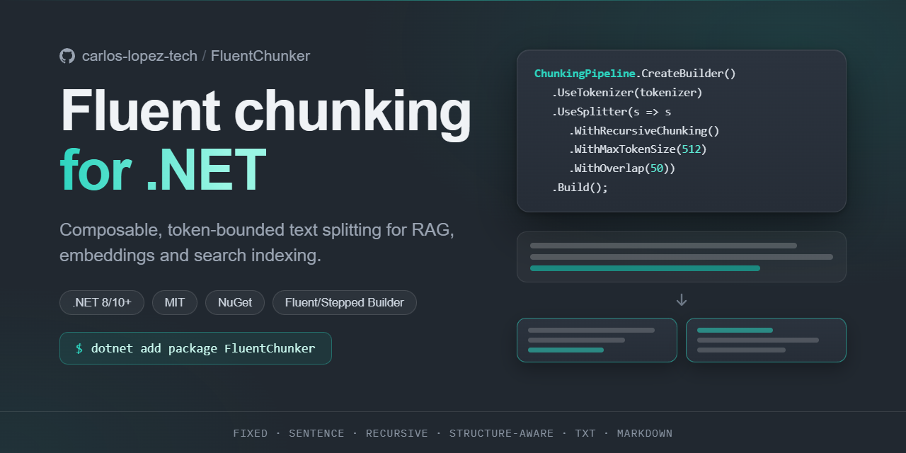

<p align="center">
  
</p>

# FluentChunker

[](https://www.nuget.org/packages/FluentChunker)
[](#requirements)
[](LICENSE.txt)
[](https://github.com/carlos-lopez-tech/FluentChunker/actions/workflows/ci.yml)
[](https://coveralls.io/github/carlos-lopez-tech/FluentChunker?branch=main)
[](https://www.nuget.org/packages/FluentChunker)
[](https://github.com/carlos-lopez-tech/FluentChunker/stargazers)
[](https://github.com/carlos-lopez-tech/FluentChunker/issues)

**Fluent Chunker** is a fluent document chunking library for .NET  
Build composable document chunking pipelines for RAG, embeddings, semantic search, vector databases, and AI applications with an intuitive fluent, step-by-step builder API.

[Features](#features) • [Quick Start](#quick-start) • [Installation](#installation) • [Usage Examples](#usage-examples) • [Measured Guarantees](#measured-guarantees) • [Tokenizers](#tokenizers) • [API Reference](#api-reference) • [Requirements](#requirements) • [Development](#development) • [License](#license)

## Features

- **Stepped Builder API**: Chain-based pipeline configuration with clear, expressive syntax; the step order is enforced at compile time
- **Fixed-size chunking**: Split text into windows of at most N tokens
- **Sentence-aware chunking** (also known as sentence-based chunking): Pack whole sentences into token-bounded chunks; never cuts mid-sentence except for a token-window fallback on sentences that alone exceed the budget. 
Boundaries are detected in Latin, CJK, Indic, Arabic, Hebrew and Thai text with no configuration
- **Recursive chunking**: Split along a fixed structural hierarchy (paragraphs, then lines, then sentences), descending a level only for pieces that exceed the budget; chunks respect the largest structural boundary possible
- **Structure-aware chunking (Markdown)**: Split Markdown documents at heading boundaries with a `headingPath` breadcrumb stamped into each chunk's metadata; code fences, tables and lists stay atomic; no overlap by design
- **Token-aware chunking**: Split text by token count with accurate token counting
- **Size against your embedding model, not just OpenAI**: Chunk with the tokenizer that will actually embed the text by passing any `Microsoft.ML.Tokenizers.Tokenizer` instance: BERT and WordPiece (BGE, E5), SentencePiece (Nomic, Qwen) and the Llama family. 
Or implement `ITokenizer` yourself. `cl100k_base` ships in the box. See [Sizing against a non-OpenAI model](#sizing-against-a-non-openai-model)
- **Overlap support**: Configure token overlap between chunks to preserve context; overlap is budgeted inside the max token size, so no chunk ever exceeds it
- **Source offsets**: Every chunk reports where it came from, so results can be cited or highlighted in the original document
- **Streaming, cancellable API**: chunks are produced lazily as `IAsyncEnumerable<Chunk>` - the first chunk is available before the last one is cut - with `CancellationToken` support end to end. 
See [Streaming and Cancellation](#streaming-and-cancellation)
- **Documents bigger than a string**: `ChunkAsync(TextReader)` streams fixed-size, sentence-aware and recursive chunking with bounded memory - one fixed-size buffer regardless of input size - and absolute `long` source offsets
- **Two metadata scopes**: Attach pipeline-level metadata (constant per run) and document-level metadata (per `ChunkAsync` call) to each chunk
- **Value-equal chunks**: `Chunk` is a true value object: deduplicate with `Distinct()`, key caches by chunk, and assert whole chunks in tests; metadata participates in equality
- **Reusable pipelines**: Build once, execute against many documents; metadata never leaks between calls

## Quick Start

```csharp
using FluentChunker;
using FluentChunker.Tokenizers;

// cl100k_base is the encoding of the OpenAI embedding models, the usual target when indexing for RAG.
// It is the encoding included with FluentChunker.
// See Tokenizers below for chat model encodings.
var tokenizer = new MicrosoftMLTokenizerAdapter("cl100k_base");

var pipeline = ChunkingPipeline.CreateBuilder()
    .UseTokenizer(tokenizer)
    .UseSplitter(s => s
        .WithFixedSizeChunking()
        .WithMaxTokenSize(512)
        .WithOverlap(50))
    .AddMetadata(meta =>
    {
        meta.Set("Source", "document.txt");
        meta.Set("Model", "text-embedding-3-small");
    })
    .Build();

await foreach (var chunk in pipeline.ChunkAsync(largeDocument, cancellationToken))
{
    Console.WriteLine($"Chunk {chunk.Index}: {chunk.Text.Length} chars, {chunk.TokenCount} tokens");
    Console.WriteLine($"  Source: {chunk.Metadata["Source"].GetString()}");
    Console.WriteLine($"  Model: {chunk.Metadata["Model"].GetString()}");
}
```

Need the chunks as a list?  
`var chunks = await pipeline.ChunkAsync(document, cancellationToken).ToListAsync(cancellationToken);` - `ToListAsync` is in the box on .NET 10 and later; on .NET 8 add the official [`System.Linq.AsyncEnumerable`](https://www.nuget.org/packages/System.Linq.AsyncEnumerable/) package.  
(The community `System.Linq.Async` package is deprecated, do not use it.)

## Installation

```bash
dotnet add package FluentChunker
```

## Migrating from 1.x to 2.0.0

2.0.0 removes the synchronous API. `ChunkingPipeline.Chunk(...)` is replaced by `ChunkAsync(...)`, which streams chunks as an `IAsyncEnumerable<Chunk>` and accepts a `CancellationToken`.

```csharp
// 1.x
var chunks = pipeline.Chunk(document);

// 2.0, stream: the first chunk is available before the last one is cut
await foreach (var chunk in pipeline.ChunkAsync(document, cancellationToken))
{
    // ...
}

// 2.0, batch: when you really need a list
var chunks = await pipeline.ChunkAsync(document, cancellationToken).ToListAsync(cancellationToken);
```

Three more changes to know about:

- Custom `IChunker` implementations move with it: `IReadOnlyList<Chunk> Chunk(string text)` becomes `IAsyncEnumerable<Chunk> ChunkAsync(string text, CancellationToken cancellationToken = default)`. 
Chunking is CPU-bound, so a synchronous core wrapped in an async iterator is the expected shape; there is nothing to push onto the thread pool.  

- `Chunk.SourceStart` is now a `long` (positions from `ChunkAsync(TextReader, ...)`, below, can exceed `int.MaxValue`). 
Verify a chunk against its source with `chunk.SliceOf(document)` instead of `document.Substring(...)` — it returns `chunk.Text` exactly for every built-in strategy and throws `InvalidOperationException` if the chunk does not track offsets.  

- The tokenizer round-trip guard (`InvalidOperationException` for a tokenizer whose decode drifts from the source) now surfaces while the chunk stream is enumerated — at the `await foreach` or the `ToListAsync` — rather than at the `ChunkAsync` call itself, because that is where the chunks are produced.

## Usage Examples

### Basic Fixed-Size Chunking

```csharp
var tokenizer = new MicrosoftMLTokenizerAdapter("cl100k_base");

var pipeline = ChunkingPipeline.CreateBuilder()
    .UseTokenizer(tokenizer)
    .UseSplitter(s => s
        .WithFixedSizeChunking()
        .WithMaxTokenSize(1024))
    .Build();

var chunks = await pipeline.ChunkAsync(text, cancellationToken).ToListAsync(cancellationToken);
```

### Chunking with Overlap

```csharp
var tokenizer = new MicrosoftMLTokenizerAdapter("cl100k_base");

var pipeline = ChunkingPipeline.CreateBuilder()
    .UseTokenizer(tokenizer)
    .UseSplitter(s => s
        .WithFixedSizeChunking()
        .WithMaxTokenSize(512)
        .WithOverlap(128))
    .Build();

var chunks = await pipeline.ChunkAsync(text, cancellationToken).ToListAsync(cancellationToken);
```

### Sentence-Aware Chunking

```csharp
var tokenizer = new MicrosoftMLTokenizerAdapter("cl100k_base");

var pipeline = ChunkingPipeline.CreateBuilder()
    .UseTokenizer(tokenizer)
    .UseSplitter(s => s
        .WithSentenceAwareChunking()
        .WithMaxTokenSize(512)
        .WithOverlap(50)
        .AddAbbreviations("Vgl.", "sog."))   // optional, additive to the built-in list
    .Build();

var chunks = await pipeline.ChunkAsync(document, cancellationToken).ToListAsync(cancellationToken);
```

Chunks contain whole sentences and are verbatim slices of the source text: whitespace and paragraph breaks between packed sentences are preserved exactly, not re-joined or trimmed.  
Every chunk's `TokenCount` stays within the configured max at any max token size of 4 or above: a sentence that alone exceeds the budget is split into evenly-sized token windows as a fallback (with `OverlapCount = 0` on those windows).  
Fallback windows are sliced from the source like every other chunk, and every boundary lands on a cut that does not fall inside a character, so the windows reconstruct the sentence exactly. 
Do not trim them before joining.

`WithOverlap(n)` carries whole trailing sentences into the next chunk, as many as fit within `n` tokens. 
`OverlapCount` reports the tokens carried *into* a chunk (0 on the first chunk), the same semantics both strategies use.

**Language support:** works with no configuration for bicameral scripts (Latin, Greek, Cyrillic) using `. ! ?`, and for caseless scripts, where a letter with no case counts as a valid sentence start.  
Recognized terminators are `. ! ?`, the Arabic question mark `؟`, the Urdu full stop `۔`, the Devanagari danda `।` and double danda `॥`, and the fullwidth forms `。 ！ ？ ．`. 
The fullwidth forms end a sentence unconditionally, since CJK is written without spaces between sentences. 
This covers Chinese, Japanese, Hindi, Urdu, Arabic, Hebrew and Thai alongside the European languages, including a passage of one script quoted inside a document written in another.  
Uppercase detection is Unicode-aware, and `¿ ¡ « „` are recognized as valid sentence openers (Spanish/French/German). 
A built-in abbreviation guard covers common EN/DE/FR/ES abbreviations (`Dr`, `Mr`, `Nr`, `bzw`, `M`, `Sra`, etc.); extend it with `.AddAbbreviations(...)`; entries may include a trailing dot, and matching is case-insensitive.

**Known limitations:** German ordinal periods (e.g. "am 3. Oktober") are falsely split; no code disambiguates them from sentence ends.  
The ellipsis `…` is not treated as a terminator, since it is at least as often mid-sentence as sentence-ending.  
CJK quote brackets (`」』】》`) are not kept attached to the sentence they close, so a closing bracket starts the following sentence.  
Thai has no sentence terminator of its own, so Thai text splits only where other punctuation appears.

### Recursive Chunking

```csharp
var tokenizer = new MicrosoftMLTokenizerAdapter("cl100k_base");

var pipeline = ChunkingPipeline.CreateBuilder()
    .UseTokenizer(tokenizer)
    .UseSplitter(s => s
        .WithRecursiveChunking()
        .WithMaxTokenSize(512)
        .WithOverlap(64)
        .AddAbbreviations("Vgl.", "sog."))   // optional, feeds the sentence tier
    .Build();

var chunks = await pipeline.ChunkAsync(document, cancellationToken).ToListAsync(cancellationToken);
```

The document is split along a fixed hierarchy of structural separators: **paragraphs** (blank-line separated), then **lines**, then **sentences** (using the same abbreviation-aware detection as sentence-aware chunking), then **balanced token windows** as a last resort.  
Only a unit that *alone* exceeds the max token size descends to the next level; adjacent small units are packed together up to the budget.  
Chunks never merge across a descent boundary: a small paragraph before or after an oversized one always stays in its own chunk, so every chunk respects the largest structural boundary possible.

Chunks are verbatim slices of the source (interior line breaks preserved), token-window fallback chunks included, since every boundary lands on a cut that does not fall inside a character, exactly like the sentence-aware fallback.

`WithOverlap(n)` carries whole trailing units (paragraphs, lines or sentences) into the next chunk, as many as fit within `n` tokens.  
Overlap applies *within* a packing run and **resets to zero at every structural seam** (before the first chunk inside an oversized unit, after the last one, and around token-window fallbacks), so carried context always comes from the same structural region.  
`OverlapCount` reports the tokens carried *into* a chunk (0 on the first chunk and wherever a seam resets it).

### Structure-Aware Chunking (Markdown)

```csharp
var tokenizer = new MicrosoftMLTokenizerAdapter("cl100k_base");

var pipeline = ChunkingPipeline.CreateBuilder()
    .UseTokenizer(tokenizer)
    .UseSplitter(s => s
        .WithStructureAwareChunking()
        .WithMaxTokenSize(512)
        .AddAbbreviations("Vgl.", "sog."))   // optional, feeds the sentence descent
    .Build();

await foreach (var chunk in pipeline.ChunkAsync(markdownDocument, cancellationToken))
{
    Console.WriteLine($"[{chunk.Metadata["headingPath"].GetString()}] {chunk.Text[..Math.Min(60, chunk.Text.Length)]}");
}
```

Designed for Markdown content: every heading (ATX `#`..`######` or Setext underline) starts a new section, and **sections are hard boundaries**: a chunk never spans two sections, even small neighboring ones.  
Every chunk carries its heading breadcrumb in `Metadata["headingPath"]` (heading texts joined with `" > "`, empty for content before the first heading), a reserved key for this strategy.  
Code fences, tables, lists and quotes are atomic: never split while they fit the budget, so a fence containing blank lines stays whole where recursive chunking's paragraph tier would cut it.  
An oversized paragraph descends to whole sentences; oversized atomic blocks and single sentences fall back to balanced token windows (sliced from the source, like the other strategies' fallbacks).

**No overlap by design:** structure is the sole boundary authority, so this strategy's builder path does not offer `WithOverlap` (misuse is a compile error) and `OverlapCount` is always `0`.  
Use recursive or sentence-aware chunking when overlap continuity matters.

**Plain text degrades gracefully** (Markdown is a superset of plain text, so nothing throws): the whole document becomes one heading-less section packed by paragraphs, with an empty `headingPath` on every chunk, which doubles as the "no structure found" signal.  
For plain-text corpora, `WithRecursiveChunking()` is the better choice; route by file type in your ingestion code, as the sample project does (`testfile.md` → structure-aware, `testfile.txt` → the other strategies).

### Streaming and Cancellation

Chunks are produced lazily, so the token is what bounds the work: pass it to `ChunkAsync` and the pipeline stops between chunks instead of running the document to completion.

```csharp
var pipeline = ChunkingPipeline.CreateBuilder()
    .UseTokenizer(tokenizer)
    .UseSplitter(s => s
        .WithRecursiveChunking()
        .WithMaxTokenSize(512))
    .Build();

// Embedding each chunk as it is cut, rather than waiting for the whole document to be split.
await foreach (var chunk in pipeline.ChunkAsync(document, cancellationToken))
{
    await index.UpsertAsync(chunk, cancellationToken);
}
```

With document-level metadata the token comes last, after the metadata callback:

```csharp
await foreach (var chunk in pipeline.ChunkAsync(doc.Markdown, meta => meta.Set("Url", doc.Url), cancellationToken))
{
    // ...
}
```

Batching takes it in both places, once for the chunking and once for the buffering:

```csharp
var chunks = await pipeline.ChunkAsync(document, cancellationToken).ToListAsync(cancellationToken);
```

When the stream is handed to a layer that owns its own token, `WithCancellation` works too, and composes with any token already given to `ChunkAsync`:

```csharp
IAsyncEnumerable<Chunk> stream = pipeline.ChunkAsync(document);

await foreach (var chunk in stream.WithCancellation(cancellationToken))
{
    // ...
}
```

**What cancelling does.** The token is observed before every chunk, and `OperationCanceledException` is thrown from the enumeration, not from the `ChunkAsync` call, because that call only builds the stream.  
A token that is already cancelled throws before the first chunk is cut, even for a document that would produce none.  
A token cancelled mid-enumeration stops the stream before the next chunk, and the chunks already yielded remain valid: nothing is buffered, rolled back, or half-written.

**How quickly it takes effect, and where it does not.** Every strategy tokenizes, splits or parses the whole document before it can cut the first chunk, and on a large document that pass is most of the wait for the first chunk.  
The token is observed inside it, so what bounds cancellation is not the length of the pass but the longest span within it that has no check. 
Those spans are calls into a tokenizer or a parser that cannot be entered:

| Strategy | Upfront pass | Longest span with no cancellation check |
|---|---|---|
| Fixed-size | tokenize the whole document | one encode batch, **~7 ms** |
| Sentence-aware | find sentence boundaries, then size each sentence | the boundary scan, **~5 ms** |
| Recursive | find paragraph boundaries, then size each paragraph | the boundary scan, **~1 ms** |
| Structure-aware | parse the Markdown, then size each block | **the Markdig parse**, tens to hundreds of ms |

Indicative figures for a 2 MB document with `cl100k_base` (Release, .NET 10); absolute timings vary widely by machine and run, the ordering does not.  
Three of the four are bounded by work whose size does not grow with the document: fixed-size batches are capped by token count, and the two boundary scans are single passes over the text.  
Structure-aware is the exception, because [Markdig](https://github.com/xoofx/markdig) parses a document in one call that has no way to report progress or accept a token, and that parse grows with the document.    
The fixed-size row assumes the built-in `MicrosoftMLTokenizerAdapter`, which can be asked for a bounded number of tokens at a time.  
A custom [`ITokenizer`](#custom-tokenizers) offers only a whole-document `Encode`, so fixed-size chunking calls it once and that call is then the uninterruptible span, growing with the document.  
Cancelling *before* enumeration begins costs nothing in any strategy: the work is lazy, so a token already cancelled when the first `MoveNextAsync` runs skips the upfront pass entirely rather than completing it and discarding the result.  
Once chunks are flowing, the token is checked before each one, which is a sub-millisecond gap for every strategy.

**Cancel at document granularity for Markdown.** For a hard bound such as a request timeout on structure-aware chunking, make one document the unit of work and cancel between documents, or cap document size at ingestion.  
A multi-MB Markdown document cannot be abandoned in less time than its parse takes.

**Chunking never yields the thread, for the `string` overload.** The work is CPU-bound, so `MoveNextAsync` completes synchronously and `await foreach` does not return control to the caller between chunks: there is no I/O to await, and nothing is pushed onto the thread pool on your behalf.  
On a UI thread or inside a request handler, wrap the enumeration in `Task.Run` when a large document would block something that matters.

**The `TextReader` overload is the exception: it does real I/O.** Each internal buffer refill awaits `TextReader.ReadBlockAsync`, a genuine yield, so `MoveNextAsync` does not always complete synchronously on that path.  
Everything between refills - segmenting, cutting a piece, delegating to the in-memory core - is the same synchronous CPU-bound work described above.  
The enumeration already yields control at each refill, so the `Task.Run` advice above is unnecessary for `ChunkAsync(TextReader, ...)`: wrapping it just moves an I/O wait onto a pool thread for no benefit.

### Source Offsets (Citation and Highlighting)

Every chunk reports the span of the original document it was taken from, so a retrieval result can be cited, highlighted in place, or re-ranked against its surrounding text without searching the document for the chunk text.

```csharp
await foreach (var chunk in pipeline.ChunkAsync(document, cancellationToken))
{
    // The offsets point back into the document the chunk came from.
    var original = chunk.SliceOf(document);
    Console.WriteLine($"[{chunk.SourceStart}..{chunk.SourceStart + chunk.SourceLength}] {chunk.Text}");
}
```

`chunk.SliceOf(document)` returns `chunk.Text` exactly, for every strategy and every input.
With overlap configured, consecutive chunks deliberately cover overlapping ranges.  
`SourceStart` is a `long` because positions in streamed sources can exceed `int.MaxValue`; both properties are `-1` on a chunk produced by an `IChunker` implemented outside this library that does not track them, and `SliceOf` then throws `InvalidOperationException` instead of slicing garbage.

### Adding Custom Metadata

```csharp
var tokenizer = new MicrosoftMLTokenizerAdapter("cl100k_base");

var pipeline = ChunkingPipeline.CreateBuilder()
    .UseTokenizer(tokenizer)
    .UseSplitter(s => s
        .WithFixedSizeChunking()
        .WithMaxTokenSize(512))
    .AddMetadata(meta =>
    {
        meta.Set("Source", "document.md");
        meta.Set("Version", "1.0");
    })
    .Build();

await foreach (var chunk in pipeline.ChunkAsync(largeDocument, cancellationToken))
{
    Console.WriteLine($"Chunk {chunk.Index}: {chunk.TokenCount} tokens");
    Console.WriteLine($"  Source: {chunk.Metadata["Source"].GetString()}");
    Console.WriteLine($"  Text: {chunk.Text[..Math.Min(80, chunk.Text.Length)]}...");
}
```

### Per-Document Metadata (Reusing One Pipeline)

Pipeline-level metadata (`AddMetadata`) is constant for the whole run; document-level metadata is passed per `ChunkAsync` call. 
On key collision, the document value wins.

```csharp
var tokenizer = new MicrosoftMLTokenizerAdapter("cl100k_base");

var pipeline = ChunkingPipeline.CreateBuilder()
    .UseTokenizer(tokenizer)
    .UseSplitter(s => s
        .WithFixedSizeChunking()
        .WithMaxTokenSize(512)
        .WithOverlap(50))
    .AddMetadata(meta => meta.Set("SourceType", "wiki"))        // run-constant
    .Build();                                                   // built once

foreach (var doc in documents)
{
    var chunks = pipeline.ChunkAsync(doc.Markdown, meta =>      // per document
    {
        meta.Set("Url", doc.Url);
        meta.Set("Title", doc.Title);
        meta.Set("CreatedAt", DateTime.UtcNow);
    }, cancellationToken);

    await foreach (var chunk in chunks)
    {
        // ...
    }
}
```

### Enriching Chunks After Chunking

`Chunk.Metadata` is immutable, and chunks are records: to add an entry, copy the chunk with `with`:

```csharp
var enriched = chunk with
{
    Metadata = chunk.Metadata.With("Reviewed", true)
};
```

`With` returns a new metadata instance and never modifies the original chunk.  
Because chunks are value-equal, two chunks with the same content and metadata compare equal: `Distinct()`, `HashSet<Chunk>`, and equality assertions in tests behave the way the `record` keyword promises.  
One caveat is documented on `ChunkMetadata`: values compare by raw JSON text, which is stricter than semantic JSON equality for hand-crafted `JsonElement`s (`1e-3` != `0.001`).

### Streaming Huge Documents (TextReader)

A multi-gigabyte document cannot exist as a .NET string.  
Hand the pipeline a `TextReader` instead: the library reads through one fixed-size buffer (262,144 chars by default), so memory stays flat regardless of input size. You own the reader; it is read forward exactly once and never disposed by the library.

It is not a slower path, and for fixed-size chunking it is the cheaper one: see [What streaming costs](#what-streaming-costs).

```csharp
using var reader = File.OpenText("very-large-corpus.txt");

await foreach (var chunk in pipeline.ChunkAsync(reader))
{
    Console.WriteLine($"[{chunk.SourceStart}..{chunk.SourceStart + chunk.SourceLength}] {chunk.TokenCount} tokens");
}
```

**Offsets in streams:** `SourceStart` is the absolute `long` position in the stream and can exceed `int.MaxValue`. 
There is no in-memory string to slice, so verification means seeking and re-reading the source; `chunk.SliceOf(document)` remains the idiom for in-memory documents.

**Seam semantics:** a chunk never spans an internal buffer seam, and overlap resets there, the same rule the strategies already apply at descent seams.  
A document that fits one buffer produces output identical to `ChunkAsync(string)`, field for field.

**Memory model per strategy:**

| Strategy | What bounds memory | What degrades at the buffer edge |
|---|---|---|
| Fixed-size | one buffer | pieces are cut after the last whitespace so words never straddle a seam; a whitespace-free full buffer is cut hard, whole |
| Sentence-aware | one buffer | a segment holding a single sentence span cannot be confirmed complete without the next sentence's start in view, so it degrades to a hard-cut, budget-sized `TokenWindows.Strided` layout with overlap 0, even when the sentence's terminator sits exactly at the buffer edge |
| Recursive | one buffer | a paragraph still unclosed when the buffer fills triggers forced descent: the buffered prefix runs through the normal paragraph, then line, then sentence ladder, with its end as a descent seam |
| Structure-aware | not supported | `ChunkAsync(TextReader)` throws `InvalidOperationException`: Markdown structure needs the whole document in memory, use `ChunkAsync(string)` |

Every degradation keeps the two hard promises: no chunk exceeds the token budget, and reading never runs more than two segment buffers ahead of the chunks you have consumed.

## Measured Guarantees

Everything the feature list promises is checked rather than asserted.  
Every chunk count and safety figure here is deterministic: run the commands at the end of this section and you will get these exact numbers back.  
The one exception is [What streaming costs](#what-streaming-costs), which is timings and says so.

Measured over a 1.2 million character public-domain document (Melville's *Moby-Dick*), at a 512-token budget with 64 tokens of overlap, counted with `cl100k_base`.  
Every chunk is re-measured with the tokenizer rather than trusted, and every chunk is compared against `SliceOf(document)`.

| Strategy | Chunks | Largest chunk | Over budget | Offsets not verbatim |
|---|---:|---:|---:|---:|
| Fixed-size | 688 | 512 | 0 | 0 |
| Sentence-aware | 700 | 512 | 0 | 0 |
| Recursive | 792 | 511 | 0 | 0 |
| Structure-aware | 947 | 511 | 0 | 0 |

No chunk exceeded its budget, and every chunk sliced back out of the source verbatim from its offsets.  
The same holds across budgets 128 and 512 and overlaps 0 and 64, which the test suite sweeps over the whole document.

### On `TokenCount`

`TokenCount` is an upper bound on the cost of encoding a chunk on its own, not always an exact match.  
Byte-pair encodings merge according to what surrounds a character, so a chunk ending in two spaces holds two tokens inside the document, where the following text keeps them apart, and one token when encoded alone.  
Across the sweep this affects at worst one chunk in 602, never by more than a single token, and only ever in the direction that leaves the chunk smaller than reported.  
A chunk sized against `TokenCount` therefore always fits the budget of whatever consumes it.

### Character safety

At a deliberately tight 64-token budget, on inputs with no convenient place to split.  
A cut through a UTF-16 surrogate pair leaves half a character behind, which only becomes U+FFFD once something encodes it, so "characters split" counts those halves directly in the chunk text before any encoding can hide them.

| Input | Chunks | Over budget | Characters split | Rebuilds the input |
|---|---:|---:|---:|---|
| CJK, no spaces | 38 | 0 | 0 | exact |
| Emoji, surrogate pairs and ZWJ | 108 | 0 | 0 | exact |
| Mixed Latin/Arabic/Hebrew/Devanagari/Thai | 75 | 0 | 0 | content complete |
| No whitespace at all | 16 | 0 | 0 | exact |

### What streaming costs

`ChunkAsync(TextReader)` exists so that a document too large to be a .NET string can be chunked at all.  
It turns out not to be a trade: on the same 1.2 million character document at a 512-token budget, the reader path is never slower than handing over the whole string.

| Strategy | In memory | Streaming | Allocated, in memory | Allocated, streaming |
|---|---:|---:|---:|---:|
| Fixed-size | 70.9 ms | 73.8 ms | 23.7 MB | 16.5 MB |
| Sentence-aware | 159.9 ms | 124.0 ms | 13.2 MB | 16.0 MB |
| Recursive | 135.2 ms | 130.4 ms | 12.5 MB | 15.0 MB |

Fixed-size allocates 30% less through the reader and reaches Gen2 far less often, because the in-memory path materialises the whole token array while the streaming path never holds more than one buffer.  
The packing strategies pay about 20% more for that buffer, having no large-object cost to save: they were already allocating roughly half what fixed-size did.

The first chunk also arrives sooner, by roughly 3.6x, because the reader has only to fill one buffer before it can cut rather than segment the whole document first.

Unlike every other table in this section, these are timings rather than guarantees.  
They move by around 10% between runs on the same machine and are not comparable across different ones, so the ranking is the durable part, not the milliseconds.  
"Never meaningfully slower" rests on more than the three rows shown: the same pairing was measured at budgets 128, 512 and 2048, and across all nine pairs the in-memory path won by at most 4%, which is inside the noise, while three favoured the reader by 13% to 22%.  
The allocation figures are the stable half of this table and reproduce between sessions to the byte.

### How this differs from `TextChunker`

`Microsoft.SemanticKernel.Text.TextChunker` is the chunker a .NET RAG project most often already has to hand.  
The difference that matters is what it hands back.

`TextChunker` returns `List<string>`.  
FluentChunker returns `Chunk`, carrying its index, its `SourceStart` and `SourceLength` in the original document, its `TokenCount`, and an immutable metadata map.  
Those offsets are what make `SliceOf(document)` possible, so a chunk can always be traced back to the span it came from, which a bare string cannot do.

The pipeline is async end to end.  
`ChunkAsync` returns `IAsyncEnumerable<Chunk>` and observes a `CancellationToken` before every chunk, and the fixed-size, sentence-aware and recursive strategies also accept a `TextReader`, chunking documents that never fit in memory.

No speed or packing comparison appears here, and that is deliberate rather than an omission.  
`TextChunker` takes a second budget parameter alongside the one you set, and its value moves the result far enough that any figure published here would describe the configuration someone chose rather than either library.  
Every number in this section is measured on this library alone, against a corpus in this repository, by a command you can run.

### Reproducing this

The guarantees are assertions in the test suite, which sweeps them over the whole document at every budget and overlap above:

```bash
dotnet test tests/FluentChunker.Tests
```

The chunk counts and packing figures are measurements, so they live with the benchmarks:

```bash
dotnet run --project benchmarks/FluentChunker.Benchmarks -c Release -- verify
```

The streaming timings need a benchmark harness rather than a stopwatch, and take a few minutes:

```bash
dotnet run --project benchmarks/FluentChunker.Benchmarks -c Release -- --filter "*StrategyBenchmarks*"
```

## Tokenizers

### MicrosoftMLTokenizer Integration

FluentChunker includes built-in support for [Microsoft.ML.Tokenizers](https://www.nuget.org/packages/Microsoft.ML.Tokenizers), enabling accurate token counting for OpenAI models:

```csharp
var tokenizer = new MicrosoftMLTokenizerAdapter("cl100k_base"); // ships with FluentChunker
var pipeline = ChunkingPipeline.CreateBuilder()
    .UseTokenizer(tokenizer)
    .UseSplitter(s => s
        .WithFixedSizeChunking()
        .WithMaxTokenSize(1024))
    .Build();
```

Need a different tokenizer?  
Pass any `Microsoft.ML.Tokenizers.Tokenizer` instance to the same adapter (see [Sizing against a non-OpenAI model](#sizing-against-a-non-openai-model) below), or implement `ITokenizer` yourself (see [Custom Tokenizers](#custom-tokenizers)).

#### Choosing an encoding

**Pick the encoding of the model that consumes the chunks.** In a RAG pipeline that is usually two different models: you size chunks against the *embedding* model when indexing, and against the *chat* model when assembling a prompt from retrieved chunks.  
The counts are not interchangeable: the same text can differ by roughly 10% between encodings, in either direction, which is enough to push prose chunked to 8,000 tokens past the 8,191 token limit of `text-embedding-3-large`.

| Encoding | Use it when your chunks feed | Included? |
|---|---|---|
| `cl100k_base` | Embedding models: `text-embedding-3-small`, `text-embedding-3-large`, `text-embedding-ada-002`. Also legacy chat: GPT-4, GPT-3.5 | **Yes** |
| `o200k_base` | GPT-4o and the newer chat and reasoning models | No, add the matching data package |
| Every other encoding | The legacy GPT-3 and Codex models, and anything else | No, add the matching data package |

The encoding is a property of the model, not of the task, so check the model card rather than assuming a newer embedding model kept `cl100k_base`.

`cl100k_base` is the encoding FluentChunker ships with, and every example in this README uses it.  
Indexing documents for retrieval is the most common reason to reach for a chunker, and that means sizing against an embedding model.

Any other encoding needs its own `Microsoft.ML.Tokenizers.Data.*` package referenced in your project.  
Without it the constructor throws an `InvalidOperationException` that names the exact package to add, so the failure tells you how to fix it.

#### Non-Latin scripts cost 2x to 5x more tokens

**A `maxTokens` value chosen against English is too small for most other scripts.** Tiktoken encodings are trained predominantly on English, so the same content costs far more tokens elsewhere.  
The same sentence, "This is a sentence about the weather today.", translated into each script and counted with `cl100k_base`:

| Script | chars | tokens | tokens/char | vs English |
|---|---|---|---|---|
| English | 43 | 9 | 0.209 | 1.00x |
| Spanish | 41 | 10 | 0.244 | 1.17x |
| German | 44 | 12 | 0.273 | 1.30x |
| Russian | 36 | 16 | 0.444 | 2.12x |
| Arabic | 24 | 18 | 0.750 | 3.58x |
| Greek | 44 | 36 | 0.818 | 3.91x |
| Japanese | 17 | 15 | 0.882 | 4.22x |
| Thai | 36 | 34 | 0.944 | 4.51x |
| Korean | 20 | 19 | 0.950 | 4.54x |
| Hindi | 38 | 38 | 1.000 | 4.78x |
| Urdu | 38 | 39 | 1.026 | 4.90x |
| Hebrew | 28 | 29 | 1.036 | 4.95x |
| Chinese | 14 | 15 | 1.071 | 5.12x |

Greek and Russian are affected too, which is easy to overlook because both are cased alphabetic scripts that read as "close to Latin".

**What goes wrong if you ignore this.** Sentence-aware, recursive and structure-aware chunking pack whole units into each chunk.  
A unit that alone exceeds the budget cannot be packed, so it falls back to token windows, which cut mid-sentence and mid-word.  
Set `WithMaxTokenSize(64)` and you get clean one-sentence chunks in English; feed the same pipeline Hindi, where a typical sentence costs 4.8x more, and sentences start exceeding the budget on their own and come back fragmented.  
That is the fallback doing its job, not a detection failure.  
Sentence detection itself works across these scripts without configuration.

**What to do.** Scale `maxTokens` by the multiplier for your corpus rather than reusing an English-derived value, and make sure the budget comfortably exceeds your longest single sentence in the target script.  
Sized that way, sentence-aware chunking reproduces sentence boundaries exactly in Chinese, Japanese, Hindi, Arabic, Hebrew, Urdu, Greek and Russian.  
Note that this is a budget concern only: no chunk ever exceeds `maxTokens`, in any script.

#### Sizing against a non-OpenAI model

`MicrosoftMLTokenizerAdapter` also accepts any `Microsoft.ML.Tokenizers.Tokenizer` instance, which covers the tokenizers behind the open embedding models:  
BERT and WordPiece for BGE and E5, SentencePiece for Nomic and Qwen, and the Llama family.

```csharp
using Microsoft.ML.Tokenizers;

// BERT-based embedding models such as BGE and E5
var bert = BertTokenizer.Create("vocab.txt", new BertOptions { LowerCaseBeforeTokenization = false });

var pipeline = ChunkingPipeline.CreateBuilder()
    .UseTokenizer(new MicrosoftMLTokenizerAdapter(bert))
    .UseSplitter(s => s
        .WithSentenceAwareChunking()
        .WithMaxTokenSize(512))
    .Build();
```

```csharp
// SentencePiece models such as Nomic and Qwen, and the Llama family
using var model = File.OpenRead("tokenizer.model");
var tokenizer = new MicrosoftMLTokenizerAdapter(SentencePieceTokenizer.Create(model));
```

**Check the round trip before you index anything with it.** FluentChunker decodes token runs both to find legal cut points and to measure how far a chunk extends in the source, so it requires a tokenizer whose `Decode` reproduces the encoded text exactly.  
A tokenizer that normalises text still counts tokens correctly, but chunk boundaries are then derived from decoded lengths that drift from the source.

**FluentChunker throws `InvalidOperationException` when that drift changes the decoded length, instead of returning truncated output.** The throw surfaces while the chunk stream is enumerated, at the first affected window, so put your error handling around the `await foreach` (or `ToListAsync`) rather than the `ChunkAsync` call.  
The table below is the behaviour that guard exists to prevent, measured against a `BertTokenizer` whose vocabulary did not cover the text, on a 185-character document at an 8-token budget:

| | Shipped `cl100k_base` | Normalising tokenizer, before the guard |
|---|---|---|
| Chunks produced | 5 | 2 |
| Longest chunk | 42 chars | 180 chars |
| Characters never emitted | 0 | 4, the end of the document |
| Chunks reassemble to the source | Yes | No |

That column now throws rather than returning those chunks.  
Note what did **not** fail while it was silent: `chunk.SliceOf(document) == chunk.Text` held for every chunk in both runs.  
The offsets stay internally consistent, so the obvious sanity check passes on truncated output, and no inspection of the chunks reveals the problem.

**Run the round trip anyway.** The guard compares decoded lengths, so a normalisation that preserves length passes it: BERT lowercasing plain ASCII produces correct chunks and correctly does not throw, but the same tokenizer meeting one out-of-vocabulary word does.  
The guard turns a silent failure into a loud one at chunking time; the round trip tells you before you get there.

Paste this into your own project and run it over a representative sample of your corpus:

```csharp
static string? FindRoundTripFailure(ITokenizer tokenizer, IEnumerable<string> corpus)
{
    foreach (var text in corpus)
    {
        if (tokenizer.Decode(tokenizer.Encode(text)) != text)
            return text;
    }

    return null; // every sample survived the round trip
}
```

The failure is not hypothetical. Two common causes, both reproducible with `BertTokenizer`:

| Cause | Effect on `Decode(Encode(text))` |
|---|---|
| `LowerCaseBeforeTokenization`, on by default for BERT | `"The state of a program."` comes back as `"the state of a program."` |
| A word missing from the vocabulary | That word comes back as `"[UNK]"` |

The first is why the example above sets `LowerCaseBeforeTokenization = false`.  
The second cannot be configured away: it depends on your text matching the model's vocabulary, which is exactly what the check above measures.  
SentencePiece and Llama tokenizers carry their own normalisation, so run the check for those too.  
`cl100k_base`, the encoding FluentChunker ships, round-trips exactly and is covered by the test suite.

### Custom Tokenizers

Implement `ITokenizer` to use your own tokenization logic:

```csharp
public class CustomTokenizer : ITokenizer
{
    public IReadOnlyList<int> Encode(string text) => /* your tokenization */;

    public string Decode(IReadOnlyList<int> tokens) => /* your detokenization */;

    // Called once per candidate chunk, so count directly rather than building the token list when your tokenizer can.
    public int CountTokens(string text) => /* your token count */;
}

var tokenizer = new CustomTokenizer();
var pipeline = ChunkingPipeline.CreateBuilder()
    .UseTokenizer(tokenizer)
    .UseSplitter(s => s
        .WithFixedSizeChunking()
        .WithMaxTokenSize(512))
    .Build();
```

All three methods (`Encode`, `Decode`, `CountTokens`) are required by the `ITokenizer` interface.

## API Reference

### Building a pipeline

The builder is stepped: each method returns the next step, so the order below is enforced at compile time:

- `ChunkingPipeline.CreateBuilder()`: Start a new pipeline configuration
- `.UseTokenizer(ITokenizer tokenizer)`: Set the tokenizer for token counting
- `.UseSplitter(Action<Splitter.Builder> configure)`: Configure the chunking strategy
- `.AddMetadata(Action<MetadataBuilder> configure)` (optional): add pipeline-level metadata to all chunks (may be called multiple times; callbacks compose)
- `.Build()`: Create the pipeline

### Splitter.Builder (inside UseSplitter)

Also stepped, in this order:

- `.WithFixedSizeChunking()`: Select the fixed-size strategy
- `.WithSentenceAwareChunking()`: Select the sentence-aware strategy (peer of `WithFixedSizeChunking`)
- `.WithRecursiveChunking()`: Select the recursive strategy (paragraphs, then lines, then sentences, then token windows), descending only for oversized pieces (peer of the other two strategy methods)
- `.WithStructureAwareChunking()`: Select the structure-aware Markdown strategy (peer of the other three strategy methods); its follow-up steps offer `WithMaxTokenSize` and `AddAbbreviations` but deliberately no `WithOverlap`
- `.WithMaxTokenSize(int maxTokens)`: Maximum tokens per chunk (must be at least 4, the most tokens a single character can span, since a character is never split across chunks)
- `.WithOverlap(int overlap)` (optional): tokens shared between consecutive chunks (must be non-negative and smaller than the max token size; budgeted inside it, not added on top)
- `.AddAbbreviations(params string[] abbreviations)` (optional): additional abbreviations (beyond the built-in EN/DE/FR/ES set) that should not be treated as sentence endings; entries may include a trailing dot, matching is case-insensitive.  
Only the abbreviation guard is language-specific, so no configuration is needed for the non-Latin scripts listed above.  
May be called multiple times; entries accumulate rather than replace.  
Used by the strategies with a sentence tier (`WithSentenceAwareChunking()`, `WithRecursiveChunking()` and `WithStructureAwareChunking()`); has no effect when combined with `WithFixedSizeChunking()`.

### ChunkingPipeline

- `.ChunkAsync(string document, CancellationToken cancellationToken = default)`: Run the pipeline, streaming chunks lazily in document order
- `.ChunkAsync(string document, Action<MetadataBuilder>? configureMetadata, CancellationToken cancellationToken = default)`: Run with additional document-level metadata; merged over the pipeline metadata, document values win on key collision
- `.ChunkAsync(TextReader reader, CancellationToken cancellationToken = default)`: Stream a document with bounded memory (strategy must support streaming)
- `.ChunkAsync(TextReader reader, Action<MetadataBuilder>? configureMetadata, CancellationToken cancellationToken = default)`: Same, with document-level metadata

### Chunk

Each chunk contains:
- `Index`: Zero-based position in the chunk sequence (resets per `ChunkAsync` call)
- `SourceStart`: Index in the source document where `Text` begins, or `-1` when the chunker does not track it; a `long`, because positions in streamed sources can exceed `int.MaxValue`
- `SourceLength`: Length of `Text` in the source document, or `-1` when the chunker does not track it. 
`chunk.SliceOf(document)` returns `Text` exactly; with overlap configured, consecutive chunks deliberately cover overlapping ranges
- `SliceOf(string document)`: The verification idiom — returns the verbatim source slice (equal to `Text` for every built-in strategy); throws `InvalidOperationException` when offsets are untracked
- `Text`: The actual chunk content
- `TokenCount`: Number of tokens the pipeline measured for this chunk; never exceeds the max token size.  
An upper bound on the cost of encoding `Text` on its own rather than always an exact match, for the byte-pair reason described under [On `TokenCount`](#on-tokencount)
- `OverlapCount`: Tokens carried into this chunk from the previous chunk (`0` on the first chunk)
- `Metadata`: Immutable map of custom key-value pairs as `JsonElement` (read with e.g. `chunk.Metadata["Source"].GetString()`; add entries with `chunk with { Metadata = chunk.Metadata.With("Key", value) }`)

### ITokenizer

Implement to use custom tokenization:
- `IReadOnlyList<int> Encode(string text)`: Convert text to token IDs
- `string Decode(IReadOnlyList<int> tokens)`: Convert token IDs back to text
- `int CountTokens(string text)`: Count the number of tokens in the text without materializing the token list

### IStreamingChunker

Implemented by the strategies that can read from a `TextReader` with bounded memory (fixed-size, sentence-aware, recursive).  
A custom `IChunker` opts into streaming by implementing it; the pipeline routes `ChunkAsync(TextReader)` to it and throws an actionable `InvalidOperationException` for strategies that do not.

## Requirements

- .NET 8.0 or later (the package targets `net8.0`, `net10.0` and `net11.0`)
- Microsoft.ML.Tokenizers 2.0.0 or later, with the `cl100k_base` data package (included as dependencies)
- Markdig 1.3.2 or later (included as dependency; used by structure-aware chunking)
- Microsoft.Bcl.Memory 10.0.10 or later (included as dependency)
- On .NET 8 only, [`System.Linq.AsyncEnumerable`](https://www.nuget.org/packages/System.Linq.AsyncEnumerable/) if you use `ToListAsync` or other LINQ operators over the chunk stream. It is not a package dependency, and plain `await foreach` needs nothing extra; on .NET 10 and later those operators are in the BCL

## Development

### Build

```bash
dotnet build FluentChunker.slnx
```

### Test

```bash
dotnet test tests/FluentChunker.Tests
```

### Sample/Demo

```bash
dotnet run --project samples/FluentChunker.Samples.Demo
```

### Benchmarks

Timings are run locally rather than in CI, because numbers from a shared runner vary too much to compare against a previous run.

```bash
dotnet run --project benchmarks/FluentChunker.Benchmarks -c Release -- --filter "*"
```

Narrow the run with a filter, and add `--job short` while iterating:

```bash
dotnet run --project benchmarks/FluentChunker.Benchmarks -c Release -- --filter "*StrategyBenchmarks*"
```

Two further modes are not BenchmarkDotNet runs:

```bash
dotnet run --project benchmarks/FluentChunker.Benchmarks -c Release -- verify
dotnet run --project benchmarks/FluentChunker.Benchmarks -c Release -- drift
```

`verify` reports how tightly each library fills the budget it was given, alongside first-chunk latency.  
It never fails.  
The chunk invariants it used to gate on are sweeps in the test project, tagged `[Category("Sweep")]`, where a break names the strategy, the budget and the chunk instead of adding to a total.  
Skip them while iterating with `dotnet test --filter "TestCategory!=Sweep"`.

`drift` is a correctness check, so it returns an exit code and runs in CI.  
It compares chunk boundaries against a recorded baseline, because a moved boundary is a breaking change no API diff reveals: an adopter
who upgrades and gets different chunk text has to re-embed their corpus.

## License

MIT
